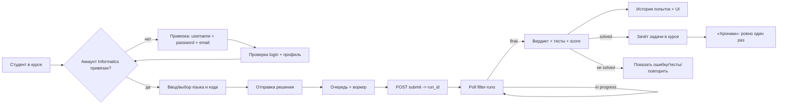

# ПРОМПТ: полный модуль интеграции с Informatics (informatics.msk.ru)

> Скопируй весь текст ниже в агента-разработчика. Это не обзор, а ТЗ + промпт:
> агент должен доработать существующий частичный модуль до production-ready,
> а не писать всё с нуля.

---

## 0. Роль, миссия и правила работы

Ты — senior full-stack инженер (Python/FastAPI + Next.js/TypeScript + PostgreSQL).
Работаешь в репозитории `D:/Zero_Knowledge` (форк LearnHouse/ZeroKnowledge).

Твоя миссия: сделать **полный, надёжный и проверяемый модуль взаимодействия с
внешним судьёй Informatics** (`https://informatics.msk.ru`):

1. привязка аккаунта Informatics к пользователю платформы;
2. отправка решения задачи из курса на Informatics;
3. приём вердикта, тестов, score, времени/памяти, ошибок компиляции/выполнения;
4. история всех попыток и лог взаимодействия;
5. зачёт задачи в курсе ровно один раз по вердикту Informatics;
6. логирование решённой задачи в «Хроники» (Google Form) ровно один раз;
7. UI студента, преподавателя и администратора;
8. тесты, миграции, наблюдаемость, безопасность.

### Жёсткие правила

- НЕ начинай с нуля. В репозитории уже есть рабочий прототип (см. §4). Изучи его,
  переиспользуй и доведи до целевого состояния.
- НЕ коммить и НЕ пушь без явного указания пользователя.
- НЕ выдумывай поля API и статусы. Если чего-то не хватает — добавь фикстуру,
  тест или явно отметь как `OPEN QUESTION`.
- НЕ логируй пароли, cookies `MoodleSession`, `Set-Cookie`, полный source code
  и персональные данные.
- НЕ обходи rate limit и НЕ хаммерь Informatics. Один аккаунт — максимум одна
  активная отправка; между запросами пауза.
- Все секреты — только из окружения. В репозиторий секреты не попадают.
- Соблюдай существующий стиль: SQLModel, async SQLAlchemy, FastAPI routers,
  сервисный слой, Next.js App Router, TanStack Query, Tailwind.
- После изменений запускай точечные тесты, а не только «весь suite».
- Итоговый отчёт: что изменено, какие файлы, какие команды проверки, что осталось.

### Definition of Done

Модуль считается готовым, когда:

- студент может привязать аккаунт, отправить решение и увидеть финальный вердикт;
- отправка не держит HTTP-запрос 90 секунд (асинхронный жизненный цикл);
- история попыток сохраняется и доступна студенту и преподавателю;
- зачёт в курсе и запись в «Хроники» идемпотентны;
- ошибки (просроченная сессия, лимит, таймаут, duplicate) обработаны явно;
- миграции применяются вверх/вниз на PostgreSQL 16;
- unit + contract + API тесты зелёные, существующие тесты не сломаны;
- UI проверен в браузере на реальном happy path и на ошибке;
- документация обновлена.

---

## 1. Контекст продукта и стека

- Продукт: ZeroKnowledge — LMS с курсами, заданиями (assignments), задачами
  (problem library), code runner и внешним судьёй Informatics.
- Backend: `apps/api`, Python 3.14, FastAPI, SQLModel/SQLAlchemy async, PostgreSQL 16,
  Redis 7, Alembic, uv.
- Frontend: `apps/web`, Next.js 16 (App Router), TypeScript, Tailwind, TanStack Query,
  i18n (ru/en).
- Collab: `apps/collab` (Hocuspocus).
- Локальный запуск: Docker Compose (`docker compose up -d`), web :3000, api :9000.
- Тесты API: `apps/api/src/tests`, pytest + pytest-asyncio.
- Тесты web: `apps/web/tests`, `bun test`.
- Текущий пользователь-админ для ручной проверки: username `admin` (вход без пароля).

### Ключевые сущности курса

- `Course` → `Chapter` → `Activity`.
- `Activity` типа `TYPE_ASSIGNMENT` связан с `Assignment`.
- `Assignment` содержит `AssignmentTask`; тип задачи `CODE`.
- `AssignmentTask.contents` — JSON. Для Informatics там лежит
  `informatics_problem_id` (integer, id задачи на informatics.msk.ru).
- `AssignmentTask.assignment_task_uuid` — стабильный id задачи.
- Сдача задания: `assignmentusersubmission` + `task_submission`,
  история попыток: `assignmentattempt`.
- Прогресс/трейл: `TrailStep`, `TrailRun`.

---

## 2. Термины

| Термин | Значение |
|---|---|
| Informatics | Внешний судья `informatics.msk.ru` (Moodle + ejudge). |
| `problem_id` | ID задачи на Informatics. Целое число, например `2936`. |
| `run_id` | ID запуска/посылки на Informatics. Целое число. |
| `lang_id` | ID языка **в терминах Informatics** (не Judge0). |
| `MoodleSession` | Cookie авторизованной сессии Moodle. Живёт только в памяти. |
| `ejudge_status` | Числовой статус ejudge внутри ответа `filter-runs`. |
| `informatics_link` | Привязка пользователя платформы к аккаунту Informatics. |
| `informatics_submission` | Наша запись о попытке/вердикте. |
| `informatics_task_map` | Маппинг `problem_id` → `TASK_XXXX` + категория «Хроник». |
| «Хроники» | Google Form, куда пишется факт решения задачи. |

---

## 3. Цель модуля (что именно должно работать)

Полный жизненный цикл:



Обязательные сценарии:

1. Привязка/перепривязка/отвязка аккаунта, проверка сессии.
2. Отправка кода на конкретный `problem_id`.
3. Асинхронное ожидание вердикта с прогрессом в UI.
4. Повторная отправка (retry) и отмена.
5. Дубликат исходника: Informatics отвечает `duplicate` — не падать, а
   прочитать вердикт последнего run.
6. Истёкшая сессия: перелогин по сохранённым (зашифрованным) credentials.
7. Язык, не поддерживаемый задачей: явная ошибка до отправки.
8. Недоступность Informatics: `503` с понятным сообщением, попытка не теряется.
9. Зачёт в курсе только при `solved` и только один раз.
10. Полная история: каждая попытка отдельной строкой, не «последняя на задачу».

---

## 4. Что уже есть в репозитории (факты, не переписывай вслепую)

### 4.1 Backend

| Файл | Что делает |
|---|---|
| `apps/api/src/services/informatics/client.py` | HTTP-клиент: `login`, `verify_session`, `submit`, `get_run`, `get_source`, `get_problem_languages`; константы `OUR_TO_INFORMATICS_LANG`, `LANG_EXT`, `IN_PROGRESS_STATUSES`, `SOLVED_STATUSES`. |
| `apps/api/src/services/informatics/links.py` | Привязка аккаунта, шифрование пароля, `submit_and_grade`: submit + синхронный poll 2 c до 90 c, upsert последнего вердикта, запуск Google Form. |
| `apps/api/src/services/informatics/statistics.py` | Личная статистика и лидерборд по `informatics_submission`. |
| `apps/api/src/services/informatics/google_form.py` | POST в Google Form «Хроники» с hidden-полями, без гарантии записи. |
| `apps/api/src/services/informatics/task_mapping.py` | CSV TASK_SUBMISSIONS → `informatics_task_map` + `contents.informatics_problem_id`. |
| `apps/api/src/services/informatics/progress.py` | Посещаемость, дедлайны, валидация категорий. |
| `apps/api/src/services/informatics/sheet.py` | Чтение Google Sheet ответов формы. |
| `apps/api/src/routers/informatics.py` | Роутер `/api/v1/informatics/*`. |
| `apps/api/src/db/informatics_link.py` | `user_id` PK, username, encrypted password, email, informatics_user_id/username, last_error, timestamps. |
| `apps/api/src/db/informatics_submission.py` | Одна строка на (user_id, problem_id), последний вердикт, `solved`, `logged_to_form`. |
| `apps/api/src/db/informatics_task_map.py` | `problem_id` PK, `task_id`, `category`, `title`. |
| `apps/api/scripts/import_informatics_mapping.py` | CLI импорта CSV. |

Роутер подключён в `apps/api/src/router.py` с префиксом `/informatics`.
Полный путь: `/api/v1/informatics`.

Текущие эндпоинты:

```
GET    /api/v1/informatics/link
POST   /api/v1/informatics/link
DELETE /api/v1/informatics/link
POST   /api/v1/informatics/submit
GET    /api/v1/informatics/statistics
GET    /api/v1/informatics/my-dashboard
POST   /api/v1/informatics/attendance
GET    /api/v1/informatics/deadlines
POST   /api/v1/informatics/deadlines
POST   /api/v1/informatics/completion
GET    /api/v1/informatics/form-responses
```

### 4.2 Frontend

| Файл | Что делает |
|---|---|
| `apps/web/components/Objects/Account/subpages/AccountInformatics.tsx` | Форма привязки/отвязки, статус и `last_error`. |
| `apps/web/components/Dashboard/Home/InformaticsLinkPrompt.tsx` | Баннер «привяжите аккаунт». |
| `apps/web/app/orgs/[orgslug]/dash/assignments/[assignmentuuid]/_components/TaskEditor/Subs/TaskTypes/TaskCodeObject.tsx` | CODE-задача: поле `informatics_problem_id`, кнопка «Сдать», синхронный submit, панель вердикта. |
| `apps/web/app/orgs/[orgslug]/dash/informatics/page.tsx` | Страница статистики Informatics. |
| `apps/web/services/problems/problems.ts` | Импорт задачи из Informatics в библиотеку. |

### 4.3 Известные ограничения текущей реализации (их надо устранить)

1. **Синхронный 90-секундный poll** внутри HTTP-запроса. Плохо для прокси,
   мобильных сетей, повторных кликов и масштабирования.
2. **Нет истории**: `informatics_submission` хранит только последний вердикт на
   пару (user, problem). Нельзя показать все попытки, время, ошибки, логи.
3. **Нет очереди/воркера**: при рестарте API ожидающая отправка теряется.
4. **Нет idempotency**: двойной клик может создать второй run.
5. **Нет нормального маппинга статусов**: только `IN_PROGRESS_STATUSES` и
   `SOLVED_STATUSES`; остальные не имеют человекочитаемых названий и категорий.
6. **Жёсткий маппинг 4 языков** (`71→27`, `54→3`, `50→2`, `62→18`); нет JS/Bash
   и нет проверки допустимых языков конкретной задачи.
7. **Пароль хранится обратимо** (Fernet). Для прототипа допустимо, но надо
   явно задокументировать модель угроз и минимизировать доступ.
8. **Нет CSRF/rate-limit/аудита** на части эндпоинтов; статистика и
   `form-responses` доступны любому авторизованному пользователю.
9. **Нет контрактных тестов** протокола Informatics; всё проверяется вручную.
10. **Google Form** может вернуть 200 и молча не записать строку; нет outbox и
    повторных попыток с идемпотентностью.
11. **Зачёт в курсе** после Informatics дополнительно прогоняет локальные
    скрытые тесты; при расхождении тестов возможен ложный незачёт.
12. **Нет наблюдаемости**: нет метрик очереди, возраста ожидания, доли ошибок.

---

## 5. Целевая архитектура

### 5.1 Слои

```
API router (HTTP, auth, validation, rate limit)
  └── SubmissionService (use cases, транзакции, права)
        ├── InformaticsClient (protocol adapter, чистый HTTP)
        ├── InformaticsRepository (SQLModel queries)
        ├── VerdictMapper (ejudge_status -> domain verdict)
        ├── SubmissionQueue (DB outbox + Redis wakeup)
        ├── SubmissionWorker (async poller, leases, retries)
        ├── CourseCreditService (зачёт task/attempt/trail ровно один раз)
        └── ChroniclesOutbox (Google Form, retries, idempotency)
```

Правила:

- HTTP-слой не делает сетевые вызовы к Informatics.
- `InformaticsClient` не знает про БД и FastAPI.
- `SubmissionService` не знает про HTTP-детали; возвращает доменные объекты.
- Воркер — единственный, кто вызывает `submit`/`get_run`.
- Все внешние вызовы — через `asyncio.to_thread` (текущий клиент синхронный
  `httpx.Client`) **или** переписать клиент на `httpx.AsyncClient`. Выбери один
  вариант и придерживайся; лучше асинхронный клиент.
- Один пользователь + один `problem_id` = максимум одна активная попытка
  (Redis lock или partial unique index).

### 5.2 Асинхронный жизненный цикл

HTTP `POST /informatics/submissions`:

1. Валидирует пользователя, язык, problem_id, размер кода.
2. Проверяет привязку аккаунта.
3. Создаёт строку `informatics_submission` в статусе `QUEUED`.
4. Кладёт id в очередь (Redis list/stream + DB outbox).
5. Возвращает `202 Accepted` с `submission_uuid` **за миллисекунды**.

Воркер:

1. Забирает задачу с lease (`FOR UPDATE SKIP LOCKED`).
2. Логинится в Informatics (или переиспользует сессию из памяти/Redis TTL).
3. Вызывает `submit`, сохраняет `run_id`, статус `RUNNING`.
4. Поллит `filter-runs` с backoff: 1 c, 2 c, 3 c, 5 c, 5 c… до 10 минут.
5. На финальном статусе маппит вердикт, сохраняет попытку, ставит `FINAL`.
6. При `solved` — атомарно зачитывает задачу в курсе и ставит в outbox «Хроники».
7. Ошибки: `RETRY_WAIT` с exponential backoff + jitter, максимум N попыток;
   после — `FAILED` с `last_error`.

Клиент UI поллит `GET /informatics/submissions/{uuid}` раз в 1–2 секунды,
пока статус не финальный.

### 5.3 Состояния

```
QUEUED
  -> SUBMITTING
  -> RUNNING
  -> FINAL            (verdict final, solved=true/false)
  -> CREDITED         (опционально: зачёт в курсе завершён)
Любое:
  -> RETRY_WAIT -> SUBMITTING
  -> FAILED
  -> CANCELED
```

Требования:

- Переходы только вперёд; терминальные статусы неизменяемы.
- Каждый переход — запись в `informatics_submission_event`.
- `attempt_count`, `next_poll_at`, `lease_owner`, `lease_expires_at`,
  `last_error`, `last_http_status`.
- Crash recovery: воркер при старте подхватывает `SUBMITTING/RUNNING` с
  истёкшим lease.

---

## 6. Протокол Informatics (точные детали)

База: `https://informatics.msk.ru`, таймаут 30 c, `User-Agent: Mozilla/5.0`,
заголовок `X-Requested-With: XMLHttpRequest` для JSON-эндпоинтов.

### 6.1 Логин

```
GET  /                      # получить cookies и страницу
GET  /login/index.php       # вытащить name="logintoken" value="..."
POST /login/index.php
  form: username, password, logintoken, anchor=""
```

Успех:

- появился cookie `MoodleSession`;
- на `/` есть строка `Вы зашли под именем`;
- из HTML извлекается `profile.php?id=<informatics_user_id>` (fallback
  `/user/view.php?id=...`);
- имя пользователя — текст после `Вы зашли под именем`.

Ошибки:

- нет `MoodleSession` → `login failed`;
- нет строки `Вы зашли под именем` → неверные credentials;
- нет id → `could not resolve user id`.

Требования:

- Никогда не логировать `password`, `Set-Cookie`, `MoodleSession`.
- Хранить только зашифрованный пароль (как сейчас).
- Cookie — только в памяти на время операции; не писать в БД/Redis в открытом
  виде. Если кэшируешь сессию — шифруй и ставь TTL ≤ 15 минут.
- Перед каждой отправкой можно проверить `verify_session`; при истечении —
  перелогин один раз.

### 6.2 Отправка

```
POST /py/problem/{problem_id}/submit
  multipart: file=solution.<ext>, lang_id=<informatics_lang_id>
```

Успех: HTTP 200, JSON:

```json
{"status": "success", "data": {"run_id": 123456789}}
```

Ошибки:

- HTTP != 200 → `submit failed: HTTP <code> <body[:200]>`;
- `status != "success"` или нет `run_id` → `submit rejected: <body[:300]>`;
- текст содержит `duplicate` → **не ошибка пользователя**: получить последний
  run через `filter-runs` и вернуть его вердикт.

### 6.3 Поллинг вердикта

```
GET /py/problem/{problem_id}/filter-runs
  problem_id=<id>
  from_timestamp=-1
  to_timestamp=-1
  user_id=<informatics_user_id>
  lang_id=-1
  status_id=-1
  statement_id=0
  count=10
  with_comment=
  page=1
```

Ответ: JSON `{"data": [run, ...]}`, где run содержит:

- `id` — run_id;
- `ejudge_status` — числовой статус;
- `ejudge_test_num` — номер теста;
- `ejudge_score` — score;
- `lang_id` — язык.

Правила:

- Искать именно свой `run_id`; если `run_id=None` — брать самый свежий run
  пользователя (для duplicate).
- `IN_PROGRESS_STATUSES = {11, 96, 98, 377}` — ещё не финал, вернуть `None`.
- Иначе — финальный вердикт.
- `SOLVED_STATUSES = {0, 8}` — задача решена.
- Расширь таблицу статусов по реальным фикстурам; для неизвестного статуса
  показывай `status <id>` и логируй warning, но не падай.

### 6.4 Исходник посылки

```
GET /py/problem/run/{run_id}/source
```

Ответ: `{"data": {"source": "..."}}`.
Использовать для истории/просмотра преподавателем, если разрешено политикой.
Не отдавать чужой source студенту.

### 6.5 Каталог задачи и языки

```
GET /py/problem/{problem_id}/json
```

Публичный (без авторизации). Содержит statement, limits, `languages`
(`[{"id": ..., "name": ...}, ...]`).

Требования:

- Кэшировать каталог в `informatics_problem` (TTL, например 24 часа).
- Перед отправкой проверять, что выбранный язык есть в списке задачи.
- Если языка нет — вернуть `422` с понятным сообщением и списком допустимых.

### 6.6 Маппинг языков

Текущий:

| Judge0/наш | Informatics | Расширение |
|---:|---:|---|
| 71 | 27 | py |
| 54 | 3 | cpp |
| 50 | 2 | c |
| 62 | 18 | java |

Требуется:

- Вынести в декларативную таблицу с полями: `our_id`, `informatics_id`,
  `label`, `extension`, `family`.
- Добавить как минимум Node.js и Bash, если Informatics их поддерживает:
  проверить через `/py/problem/<id>/json` и реальную отправку.
- Не угадывать: неизвестный язык → явная ошибка, а не `txt`.
- UI должен показывать только пересечение «языки задачи × наши языки».

### 6.7 Ограничения и вежливость

- Один активный submit на пару (user, problem).
- Минимум 1–2 секунды между HTTP-запросами к Informatics на аккаунт.
- Глобальный лимит, например 30 запросов/минуту на инстанс, настраиваемый.
- При HTTP 429/5xx — backoff с jitter, не более N попыток.
- Не более 10 минут ожидания вердикта; после — `FAILED` с `TIMEOUT`,
  но run_id сохранить, чтобы можно было «догнать» позже.
- Не выполнять параллельные submit одного пользователя.

---

## 7. Целевая модель данных

Все новые таблицы — SQLModel + Alembic, один head, up/down проверены на
PostgreSQL 16. Имена snake_case. Даты — ISO строки, как в проекте, либо
`DateTime` — выбери единый стиль и не смешивай.

### 7.1 `informatics_link` (доработать)

```text
user_id                 PK, FK user.id ON DELETE CASCADE
username                varchar(255)
password_encrypted      text            # Fernet, никогда не отдавать
email                   varchar(255)
informatics_user_id     int
informatics_username    varchar(255)
status                  enum: ACTIVE | INVALID | UNVERIFIED
last_verified_at        timestamp
last_error              text | null
created_at, updated_at
```

Индексы: `uq_informatics_link_user` (PK уже), `ix_informatics_link_informatics_user`.
Не хранить cookie.

### 7.2 `informatics_submission` (переделать в append-only)

Одна строка = одна попытка. Старую таблицу мигрировать:

- сохранить последние строки как первую попытку;
- не терять `solved`/`logged_to_form`.

```text
id                      PK
submission_uuid         varchar(64) UNIQUE
user_id                 FK user.id
problem_id              int
assignment_task_uuid    varchar(64) | null
assignment_uuid         varchar(64) | null
activity_uuid           varchar(64) | null
org_id                  int | null
language_our_id         int
language_informatics_id int
source_sha256           char(64)
source_code             text | null   # по политике; можно хранить только hash
attempt_no              int
status                  enum: QUEUED|SUBMITTING|RUNNING|FINAL|RETRY_WAIT|FAILED|CANCELED
verdict                 enum: ACCEPTED|WRONG_ANSWER|COMPILATION_ERROR|RUNTIME_ERROR|
                              TIME_LIMIT|MEMORY_LIMIT|PRESENTATION_ERROR|PARTIAL|
                              INTERNAL_ERROR|UNKNOWN
ejudge_status           int | null
run_id                  bigint | null
tests_passed            int | null
tests_total             int | null
score                   int | null
max_score               int | null
time_ms                 int | null
memory_kb               int | null
compile_output          text | null
stderr                  text | null
message                 text | null
raw_verdict             jsonb | null
last_http_status        int | null
last_error              text | null
attempt_count           int default 0
next_poll_at            timestamptz | null
lease_owner             varchar(128) | null
lease_expires_at        timestamptz | null
credited                bool default false
credited_at             timestamptz | null
chronicles_logged       bool default false
chronicles_logged_at    timestamptz | null
created_at, updated_at, finished_at
```

Индексы:

- `(user_id, problem_id, created_at desc)`;
- `(status, next_poll_at)`;
- `(assignment_task_uuid)`;
- `(run_id)` unique where not null;
- partial unique `(user_id, problem_id) WHERE status IN ('QUEUED','SUBMITTING','RUNNING')`
  — не более одной активной попытки.

### 7.3 `informatics_submission_event`

Аудит/лог взаимодействия:

```text
id, submission_id FK, at, phase, level, message, http_status, payload jsonb
```

Писать: queued, submit_request, submit_response, poll_start, poll_result,
verdict, credit, chronicles, error. Секреты вычищать.

### 7.4 `informatics_problem`

Кэш каталога:

```text
problem_id PK, title, statement_md?, languages jsonb, time_limit_ms,
memory_limit_kb, raw jsonb, fetched_at
```

Statement можно не хранить, если он уже импортирован в библиотеку; реши и
задокументируй.

### 7.5 `informatics_task_map` (оставить)

`problem_id` PK, `task_id`, `category`, `title`.
Добавить `source` (CSV/API/manual) и `updated_at`, если нужно.

### 7.6 `informatics_chronicles_outbox`

Вместо `logged_to_form bool`:

```text
id, submission_id FK, problem_id, user_id, task_id, email_hash | email,
status enum PENDING|SENT|FAILED|UNKNOWN, attempts, last_error,
next_attempt_at, created_at, sent_at
```

Уникальность `(submission_id)` или `(user_id, problem_id)` — чтобы не дублировать.

### 7.7 Миграции

- Одна Alembic-ревизия (или несколько, но один head).
- `alembic upgrade head` и `alembic downgrade -1` на чистой PostgreSQL 16.
- Перенос данных из старой `informatics_submission` без потери `solved`.
- Индексы и FK — явно.

---

## 8. Вердикты и отображение

Введи доменный enum (`Verdict`) и маппер `ejudge_status -> Verdict`.
Рекомендуемая таблица (подтверждай фикстурами; неизвестное — `UNKNOWN`):

| ejudge | Домен | UI (ru) |
|---:|---|---|
| 0 | ACCEPTED | Принято |
| 8 | ACCEPTED | Принято |
| 11, 96, 98, 377 | (in progress) | Проверяется… |
| 1..7, 9, 10, 12+ | по факту | Показать raw + категорию |

Не выдумывай точные названия статусов. Собери реальные пары
`ejudge_status → текст` из ответов Informatics и зафиксируй в
`verdict_mapping.py` + фикстурах. Для неизвестного статуса:

```json
{"verdict":"UNKNOWN","ejudge_status":123,"message":"Informatics status 123"}
```

и `logger.warning`.

UI обязан показывать:

- человекочитаемый вердикт;
- `tests_passed/tests_total`, `score/max_score`;
- время и память;
- `compile_output` при CE;
- `stderr` при RE;
- сырой статус в details (сворачиваемый блок);
- «Повторить», «Отмена», «История».

---

## 9. API (целевое)

Все пути под `/api/v1/informatics`. Аутентификация — текущая сессия/JWT.
API-токены к Informatics **не допускаются**.

### 9.1 Аккаунт

```
GET    /link
POST   /link        {username, password, email}
DELETE /link
POST   /link/verify # перелогин и обновление статуса
```

Ответ `GET /link`:

```json
{
  "linked": true,
  "status": "ACTIVE",
  "informatics_user_id": 12345,
  "informatics_username": "ivan",
  "email": "ivan@example.com",
  "last_verified_at": "2026-11-24T10:00:00",
  "last_error": null
}
```

Никогда не возвращать password/cookie.

### 9.2 Отправки

```
POST /submissions                 -> 202 {submission_uuid, status:"QUEUED"}
GET  /submissions/{uuid}          -> статус/вердикт/логи
GET  /submissions                 -> история (cursor/limit, фильтры)
POST /submissions/{uuid}/retry    -> 202 новая попытка
POST /submissions/{uuid}/cancel   -> 200/409
```

`POST /submissions` body:

```json
{
  "problem_id": 2936,
  "language_id": 71,
  "source_code": "...",
  "assignment_task_uuid": "assignmenttask_...",
  "assignment_uuid": "assignment_...",
  "client_request_id": "uuid-v4"
}
```

Правила:

- `client_request_id` — идемпотентность; повтор с тем же id возвращает ту же
  попытку.
- Если уже есть активная попытка на (user, problem) — вернуть `409` с её uuid
  либо `200` с ней (выбери и задокументируй).
- `source_code` ≤ 64 KiB; пустой — `400`.
- Язык не из задачи — `422`.
- Нет привязки — `400`/`409` с кодом `INFORMATICS_NOT_LINKED`.

`GET /submissions/{uuid}`:

```json
{
  "submission_uuid": "...",
  "status": "RUNNING",
  "verdict": null,
  "run_id": 123456789,
  "tests_passed": null,
  "tests_total": null,
  "score": null,
  "max_score": null,
  "time_ms": null,
  "memory_kb": null,
  "compile_output": null,
  "stderr": null,
  "message": null,
  "created_at": "...",
  "updated_at": "...",
  "events": [{"at":"...","phase":"poll","message":"..."}]
}
```

История:

```
GET /submissions?problem_id=2936&status=FINAL&limit=50&cursor=...
```

Студент видит только свои. Преподаватель — в рамках org и только при
`assignments.action_update`. Админ — всё.

### 9.3 Каталог

```
GET /problems/{problem_id}         -> {title, languages, limits, cached_at}
GET /problems/{problem_id}/languages
POST /problems/{problem_id}/refresh
```

### 9.4 Админ/health

```
GET /health                        -> {queue_depth, oldest_queued_age_s,
                                       running, failed_24h, informatics_ok,
                                       workers, last_error}
POST /admin/requeue/{uuid}         -> повторно поставить в очередь
POST /admin/reconcile/{uuid}       -> дочитать run_id и финализировать
```

Права: superadmin или отдельный permission. Не отдавать всем.

### 9.5 Обратная совместимость

- Сохранить `POST /submit` как обёртку: либо ждать финал (deprecated), либо
  вернуть `202` и редиректить на новый формат. UI перевести на новый API.
- Не ломать существующие поля `solved`, `status`, `tests`, `score`, `run_id`
  в ответе старого `/submit`, пока UI не мигрирован.

---

## 10. UI/UX

### 10.1 Студент в CODE-задаче

Блок «Informatics» показывается, если `contents.informatics_problem_id != null`.

Состояния:

1. Аккаунт не привязан → баннер + ссылка «Привязать» (`/account/connections`).
2. Привязан → «Задача №2936 · Informatics», выбранный язык, кнопки:
   - `Run` — локальный runner (не отправляет в Informatics);
   - `Сдать в Informatics` — создаёт submission;
   - после создания — статус `В очереди / Отправляется / Проверяется…`
     с spinner и таймером;
   - финал — панель вердикта;
   - ошибка — текст + «Повторить».
3. История — раскрывающийся список попыток: дата, язык, вердикт, тесты,
   score, время, ссылка на детали.
4. Отмена доступна только до `RUNNING`.
5. Двойной клик не создаёт вторую попытку (idempotency + disabled).

Запрещено:

- блокировать весь экран на 90 секунд;
- показывать «Accepted» до финального вердикта;
- показывать чужие source/verdict;
- терять введённый код при ошибке.

### 10.2 Страница аккаунта

- Показать статус `ACTIVE/INVALID`, `informatics_username`, email,
  `last_verified_at`, `last_error`.
- Кнопки «Проверить», «Отвязать», «Перепривязать».
- Пароль не показывать; поле только для ввода нового.
- После успешной привязки — инвалидировать кеши `informatics/link`,
  `informatics/my-dashboard`.

### 10.3 Преподаватель

В редакторе задания:

- поле `informatics_problem_id` с валидацией через `GET /problems/{id}`;
- предпросмотр доступных языков и лимитов;
- таблица студентов: кто отправлял, последний вердикт, попытки, score;
- действия: «Перепроверить», «Переотправить» (с подтверждением), «Открыть лог»;
- фильтр «застрявшие» (`RUNNING` > 5 минут), «ошибки».

### 10.4 Админ

- очередь, возраст старейшей задачи, воркеры, ошибки за 24 ч;
- кнопки requeue/reconcile;
- health Informatics (последний успешный логин/запрос).

### 10.5 i18n и доступность

- Все строки через `t(...)`, ключи в `apps/web/locales`.
- RU и EN как минимум.
- Кнопки с `aria-label`, статус — `role="status"`, ошибки — `role="alert"`.
- Не полагаться только на цвет.

---

## 11. Интеграция с курсом, прогрессом и «Хрониками»

### 11.1 Зачёт задачи

Правило: **вердикт Informatics — авторитетный** для задачи с
`informatics_problem_id`.

- `verdict == ACCEPTED` → зачесть `AssignmentTask` ровно один раз.
- Не запускать локальные скрытые тесты как обязательные после accepted
  (иначе расхождение тестов даст ложный незачёт). Локальный runner — только
  для «Run»/предпросмотра.
- Зачёт должен обновить те же сущности, что и обычная сдача:
  `task_submission`, `assignmentusersubmission`, `assignmentattempt`,
  `TrailStep`/`TrailRun` (через существующие сервисы, не прямым SQL).
- Идемпотентность: транзакция + `credited` + unique constraint/условный UPDATE.
- При `WRONG_ANSWER`/`CE`/`RE`/`TL`/`ML` зачёта нет, попытка сохраняется.
- `is_late`/`allow_late` учитывать как в текущей логике assignments.

### 11.2 «Хроники»

- Только первый переход `solved=false → true`.
- Только если есть `informatics_task_map.task_id` и email.
- Через outbox: `PENDING → SENT/FAILED`, retries с backoff.
- 200 от Google Form не гарантирует запись (sign-in restriction / silent
  reject). Статус `UNKNOWN` допустим; хранить ответ и attempts.
- Не блокировать вердикт и зачёт ожиданием формы.
- Ручной retry из админки.
- Секреты формы/email не логировать целиком (маскировать).

### 11.3 Статистика

- Считать по финальным `solved`-попыткам, не по строкам-дублям.
- Лидерборд и категории — из `informatics_task_map`/`categories`.
- Доступ: студент — только своя статистика; преподаватель — org; админ — всё.
- `form-responses` закрыть правами (сейчас доступно всем авторизованным).

---

## 12. Безопасность и приватность

1. Пароль Informatics:
   - только `encrypt_secret` (Fernet, ключ из JWT secret);
   - никогда не возвращать, не логировать, не включать в `repr`;
   - при отвязке удалять.
2. Cookie `MoodleSession`:
   - только в памяти;
   - не логировать заголовки;
   - не сохранять в БД/Redis в открытом виде.
3. Source code:
   - решить политику хранения: hash + опционально source;
   - если храним — доступ только владельцу и преподавателю org;
   - retention/удаление при отвязке или по запросу.
4. Авторизация:
   - `_require_learner` для студенческих операций;
   - API-токены запрещены;
   - проверка org/assignment доступа перед отправкой;
   - статистика/форма — только staff.
5. CSRF:
   - cookie-аутентифицированные POST/DELETE должны проходить текущую CSRF-защиту;
   - внутренние вызовы — по ключу, не по cookie.
6. Rate limiting:
   - на link/verify/submit/retry;
   - отдельно на Informatics-запросы;
   - 429 с `Retry-After`.
7. Audit:
   - link/unlink/verify/submit/retry/cancel/credit/chronicles;
   - кто, когда, какой problem/run, результат.
8. SSRF:
   - URL Informatics фиксированный;
   - `problem_id` — int, не URL;
   - никаких редиректов на произвольные хосты.
9. Ошибки наружу:
   - не отдавать stack trace/HTML Informatics;
   - сообщение пользователю + correlation id для поддержки.

---

## 13. Надёжность и производительность

- HTTP-таймауты: connect 10 c, read 30 c; общий deadline.
- Retry только идемпотентных GET; submit — без слепого повтора.
- Duplicate → прочитать существующий run.
- Poll backoff: 1, 2, 3, 5, 5, 10 c; jitter; max 10 мин.
- Хранить `next_poll_at`; воркер не крутит busy-loop.
- Lease на попытку; crash recovery.
- Redis lock `informatics:lock:user:{id}` и `...:problem:{id}`; TTL.
- Очередь: DB outbox + Redis wakeup (или Redis Stream с consumer group и
  периодическим reconcile из БД).
- Circuit breaker: после N подряд ошибок логина/сети — пауза, health `degraded`.
- Graceful shutdown: воркер доигрывает текущий шаг, lease освобождается.
- Не терять отправку при рестарте API/воркера.
- Ограничить размер `source_code` (64 KiB) и `compile_output`/`stderr`
  (например, 32 KiB) до записи в БД.

---

## 14. Наблюдаемость

Структурированные логи (JSON или текущий logging) с полями:

```
submission_uuid, user_id, problem_id, run_id, phase, http_status,
duration_ms, attempt_no, verdict, error_code
```

Метрики (если есть Prometheus/OpenTelemetry — иначе счётчики в БД/health):

- `informatics_submissions_total{status,verdict}`;
- `informatics_queue_depth`;
- `informatics_queue_oldest_age_seconds`;
- `informatics_poll_duration_seconds`;
- `informatics_http_errors_total{code}`;
- `informatics_login_failures_total`;
- `informatics_chronicles_pending`.

Health endpoint:

```json
{
  "ok": true,
  "queue_depth": 3,
  "oldest_queued_age_s": 12,
  "running": 1,
  "failed_24h": 0,
  "informatics_ok": true,
  "last_error": null
}
```

---

## 15. Тестирование

### 15.1 Unit

- `ejudge_status → Verdict` для всех известных статусов и unknown.
- Маппинг языков: наш → Informatics, расширения, несовместимый язык.
- `client.login` парсинг logintoken и профиля (HTML-фикстуры).
- `client.submit` success/duplicate/rejected.
- `client.get_run`: in progress, final, no matching run.
- sha256 source, лимиты, truncation.
- state machine: допустимые/недопустимые переходы.
- backoff/jitter.
- шифрование/дешифрование пароля.

### 15.2 Contract (без сети)

Записать фикстуры реальных ответов (без секретов):

- `login_page.html` (с `logintoken`);
- `home_logged_in.html` (`Вы зашли под именем`, profile id);
- `submit_success.json`, `submit_duplicate.json`, `submit_rejected.json`;
- `filter_runs_in_progress.json`, `filter_runs_ok.json`, `filter_runs_wa.json`;
- `run_source.json`, `problem.json`.

Поднять `httpx.MockTransport` и проверить клиент + сервис.

### 15.3 API

- auth required; API token → 403;
- link: invalid creds → 400; encrypted at rest; no password in response;
- submit: 202, idempotency, active-attempt conflict, unsupported language;
- get submission: self vs other user vs staff;
- retry/cancel;
- history pagination;
- stats authz;
- CSRF.

### 15.4 Worker

- fake clock, mock client;
- QUEUED → FINAL;
- duplicate path;
- session expiry → re-login once;
- timeout → RETRY_WAIT → FAILED;
- crash recovery с истёкшим lease;
- credit exactly once (повторный final не дублирует зачёт);
- chronicles outbox retries.

### 15.5 Интеграция/E2E (env-gated)

- Реальный тестовый аккаунт Informatics, `INFORMATICS_E2E=1`;
- отправить заведомо принятое решение и заведомо неверное;
- проверить вердикт и историю;
- по умолчанию **skip**, без сети в CI.

### 15.6 Регрессия

- Существующие тесты API и web зелёные.
- `next build` успешен.
- Миграции up/down.
- Ручная проверка в браузере: привязка → отправка → вердикт → зачёт → история.

---

## 16. Пошаговый план реализации

### Этап 1. Аудит и фикстуры

- Прочитать все файлы из §4.
- Снять реальные ответы Informatics (без секретов) и сохранить фикстуры.
- Составить таблицу статусов из реальных данных.
- Зафиксировать решения: sync vs async, хранение source, права на статистику.

### Этап 2. Модель и миграции

- Новые/изменённые таблицы из §7.
- Alembic-ревизия, up/down, перенос старых строк.
- Индексы, partial unique, FK.

### Этап 3. Клиент и маппер

- Async httpx или аккуратный sync в `to_thread`.
- Таймауты, ретраи GET, duplicate, session expiry, языки, каталог.
- `VerdictMapper`, `verdict_mapping.py`, фикстуры.
- Тесты клиента.

### Этап 4. Оркестратор и воркер

- `SubmissionService`: create/retry/cancel/get/history.
- Очередь, lease, backoff, crash recovery.
- `SubmissionWorker` + запуск/остановка в lifespan.
- Redis lock.
- Тесты state machine/worker.

### Этап 5. API

- Эндпоинты §9, схемы, коды ошибок, права, rate limit, CSRF.
- Обратная совместимость `/submit`.
- Тесты API.

### Этап 6. UI

- Account page: verify/status.
- TaskCodeObject: async submit, polling, verdict, history, retry/cancel.
- Teacher table, admin health.
- i18n, accessibility.
- Web tests + ручная проверка.

### Этап 7. Курс и «Хроники»

- Зачёт ровно один раз по accepted.
- Убрать обязательный локальный hidden-test прогон для Informatics-задач.
- Outbox «Хроник», retries, идемпотентность.
- Trail/attempt/late-политика.
- Тесты.

### Этап 8. Наблюдаемость и документация

- Health, метрики/логи, correlation id.
- `docs/content/platform/informatics.mdx` (или аналог): настройка, ограничения,
  безопасность, troubleshooting.
- Обновить README/OPERATIONS.

---

## 17. Критерии приёмки (проверяемые)

1. Привязка: неверные credentials → `400` с понятным текстом; пароль в БД
   зашифрован; в ответах/логах пароля и cookie нет.
2. `POST /submissions` отвечает `202` быстрее 500 мс (без сети Informatics).
3. Воркер доводит попытку до `FINAL`; UI показывает вердикт, тесты, score,
   время/память, CE/RE вывод.
4. Повторный `client_request_id` не создаёт второй run.
5. Двойной клик/повторная активная попытка не создают дубль.
6. Duplicate от Informatics обрабатывается чтением последнего run.
7. Истёкшая сессия → один перелогин, затем успех; иначе `FAILED` + `last_error`.
8. Accepted зачитывает задачу ровно один раз (проверить повторным финалом).
9. «Хроники» пишутся ровно один раз; сбой формы не отменяет зачёт.
10. История показывает все попытки; студент не видит чужие.
11. Преподаватель видит студентов своей org; админ — health/requeue.
12. Миграции up/down; один head.
13. Unit + contract + API + worker тесты зелёные; существующие не сломаны.
14. `next build` успешен; ручной happy path и error path проверены в браузере.
15. Нет секретов в логах/ответах; `form-responses` закрыт правами.
16. Документация обновлена.

---

## 18. Non-goals

- Не реализовывать сам судья Informatics и не лезть в его внутренности.
- Не пытаться получить скрытые тесты/чужие решения.
- Не обходить rate limit, captcha, sign-in ограничения Google Form.
- Не поддерживать multi-org Enterprise сверх текущей модели.
- Не переписывать code runner/Judge0.
- Не менять публичные контракты без backward-compatible обёртки.
- Не коммитить и не пушить.

---

## 19. Формат отчёта агента

В конце верни:

1. **Сводка**: что сделано, какие сценарии работают.
2. **Изменённые файлы**: путь + назначение.
3. **Миграции**: id, up/down, как проверял.
4. **API**: таблица метод/путь/права/коды.
5. **Тесты**: точные команды и результаты (pass/fail counts).
6. **Ручная проверка**: URL, шаги, что увидел.
7. **Риски/OPEN QUESTIONS**: что не подтверждено, что требует реального
   аккаунта Informatics.
8. **Что осталось** (если есть), без «сделаю потом» внутри заявленного объёма.

---

## 20. Приложение: текущие константы и примеры

### 20.1 Текущие константы

```python
BASE = "https://informatics.msk.ru"
TIMEOUT = 30.0

OUR_TO_INFORMATICS_LANG = {71: 27, 54: 3, 50: 2, 62: 18}
LANG_EXT = {27: "py", 3: "cpp", 2: "c", 18: "java"}

IN_PROGRESS_STATUSES = {11, 96, 98, 377}
SOLVED_STATUSES = {0, 8}

POLL_INTERVAL_SECONDS = 2.0
POLL_MAX_SECONDS = 90.0
```

### 20.2 Пример submit-ответа

```json
{"status": "success", "data": {"run_id": 123456789}}
```

### 20.3 Пример run в filter-runs

```json
{
  "id": 123456789,
  "ejudge_status": 0,
  "ejudge_test_num": 12,
  "ejudge_score": 100,
  "lang_id": 27
}
```

### 20.4 Пример проблемы (problem json)

```json
{
  "id": 2936,
  "title": "Гипотенуза",
  "languages": [{"id": 27, "name": "Python 3.9"}, {"id": 3, "name": "GNU C++"}],
  "time_limit": 1.0,
  "memory_limit": 65536
}
```

(Поля могут отличаться; проверь реальным ответом и зафиксируй фикстуру.)

### 20.5 Что нельзя ломать

- Вход по username без пароля (`admin`) должен продолжать работать.
- Текущий code runner и его языки.
- Collab/доски и gzip-фикс.
- Существующие курсы/задания/прогресс из дампа.
- Web runtime-config и локальный запуск через Docker Compose.

### 20.6 Полезные команды

```bash
# backend
cd apps/api
uv run pytest src/tests/... -q
uv run alembic heads
uv run alembic upgrade head

# web
cd apps/web
bun test
bun run next build

# stack
cd D:/Zero_Knowledge
docker compose up -d
docker compose logs -f api
docker compose ps
```

---

## 21. Стартовая инструкция агенту (кратко)

> Изучи §4 и существующий код. Составь план по §16. Реализуй поэтапно, после
> каждого этапа запускай точечные тесты. Не коммить. В конце дай отчёт по §19.
> Если реальный Informatics недоступен — используй фикстуры и явно пометь, что
> проверено только на них. Если решение по архитектуре неоднозначно — выбери
> более безопасный/простой вариант, задокументируй и продолжай.
